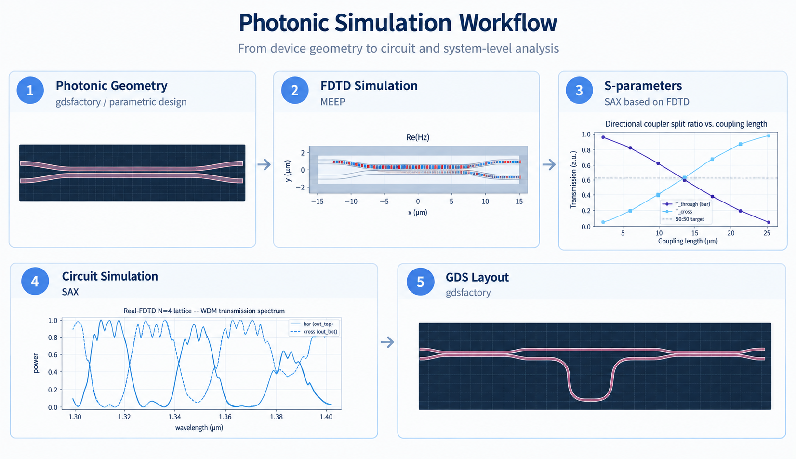

# photonics-simulation-toolkit

An end-to-end toolkit for building, physically validating, and composing
silicon photonic integrated circuit (PIC) components — from
[Meep](https://meep.readthedocs.io/) FDTD simulation, through
[SAX](https://flaport.github.io/sax/) circuit-level composition, to
[gdsfactory](https://gdsfactory.github.io/gdsfactory/) GDS layout output.



Every stage above is backed by a real Meep FDTD run — not an idealized or
pre-characterized model — and that measured physics (amplitude *and* phase)
is carried all the way through to circuit-level composition and a
fabricable GDS layout.

## The pipeline

1. **`si/notebooks/0N_*.ipynb`** — one notebook per PIC component. Builds the
   geometry (gdsfactory-first), runs a Meep FDTD simulation, characterizes
   it (S-parameters, resonance, extinction, Vπ, etc.), and saves the result
   as `si/data/design_points/<component>.yaml` — the single source of truth
   for that component's parameters and fitted/measured model.
2. **`src/pic_toolkit/models/<component>.py`** — a **Meep-free** twin of each
   component that reads its cached design point and serves it as a
   SAX-compatible model, so downstream circuit work never needs to re-run
   FDTD.
3. **`circuits/`** — SAX circuit-level compositions built purely from those
   cached component models, comparing an ideal analytic model against the
   genuinely FDTD-measured one, then exporting the result as GDS.

Each notebook is written as a reader-facing deliverable — not personal lab
notes — with a consistent structure and explicit **STOP** checkpoints before
any expensive or consequential step.

## Why this is more than a set of simulation notebooks

- **The loop actually closes.** Component-level FDTD results don't stay in
  their own notebook — `circuits/wdm_sax.ipynb` is the first module in this
  repo to call `sax.circuit()`, composing cached, genuinely FDTD-measured
  coupler and delay-arm models (preserving complex S-parameters, magnitude
  *and* phase, not just power) into a working interferometric filter, then
  exporting it as GDS.
- **Real physics measurably changes the outcome.** In
  `circuits/wdm_mux4_sax.ipynb`'s 4-channel WDM demultiplexer, moving from a
  2-coupler to a 4-coupler lattice — validated with real FDTD data, not just
  an ideal model — improved the worst channel's extinction ratio from
  **1.7 dB to 10.1 dB**. That notebook also produces this repo's first
  *branching* (non-series) GDS layout.
- **Includes a genuinely advanced simulation technique**, not just parameter
  sweeps: `04_bend_topology_optimization.ipynb` uses Meep's adjoint-based
  topology optimization (`autograd` + `nlopt`) to optimize a waveguide
  bend's geometry directly from a gradient of the simulated field.
- **10 of 12 components are fully validated end-to-end** — cached ground-truth
  YAML *and* a Meep-free SAX model — not just a one-off simulation notebook;
  see the "cached model" column below.

## Components

The notebooks are grouped by material platform: `si/` (silicon), `sin/` (silicon
nitride) and `tfln/` (thin-film lithium niobate). Each platform has its own
`notebooks/` and `data/` (design points, S-parameter artifacts, caches).

### Si track (`si/`)

| Notebook (`si/notebooks/`) | Component | Cached model |
|---|---|---|
| `01_waveguide_baseline.ipynb` | Straight waveguide baseline (TE mode, cross-section characterization) | ✅ |
| `02_bent_waveguide.ipynb` | Bent waveguide (radius sweep, circular vs. Euler bends) | ✅ |
| `03_mzi_arm.ipynb` | MZI delay arm (jog geometry) | ✅ |
| `03b_mzi_arm_dense_sweep.ipynb` | Densified ΔL sweep for the delay arm | — (supporting sweep) |
| `04_bend_topology_optimization.ipynb` | Adjoint topology optimization of a waveguide bend | ✅ |
| `04b_bend_topopt_robust.ipynb` | Fabrication-bias-robust bend topology optimization (3-way eroded/nominal/dilated averaged objective) | ✅ |
| `05_racetrack_resonator.ipynb` | Racetrack resonator | ✅ |
| `06_directional_coupler.ipynb` | Directional coupler (baseline) | ✅ |
| `06b_directional_coupler_gap_sweep.ipynb` | 2D gap × length sweep for the coupler | — (supporting sweep) |
| `07_mzi.ipynb` | Passive Mach-Zehnder interferometer | ✅ |
| `08_mzm.ipynb` | Mach-Zehnder modulator (push-pull, Δn-defined Vπ) | ✅ |
| `09_grating_coupler.ipynb` | Grating coupler (x-z cross-section) | not yet promoted |
| `10_add_drop_ring_resonator.ipynb` | Add-drop ring resonator | ✅ |

### TFLN track (`tfln/`)

| Notebook (`tfln/notebooks/`) | Component | Cached model |
|---|---|---|
| `01_tfln_mzm.ipynb` | Thin-film LiNbO₃ electro-optic MZM (Pockels VπL, traveling-wave bandwidth); formerly `notebooks/11_tfln_mzm.ipynb` | not yet promoted |

### SiN track (`sin/`, Meep 2D)

Under `sin/`, the same components are built for a
400 nm SiN strip (0.9 µm wide) in the same 2D effective-index model. The core index
(1.7650) is calibrated so that the 2D mode has the MPB n_eff of the real strip. The bend is
compared against a Si reference calibrated the same way (500 × 220 nm, core 2.944). Both
are benchmarked against published 3D results. Same modules, same band; own data and design
points (`sin/data/`), read by `models/sin_*.py`.

| Notebook | Component |
|---|---|
| `sin/notebooks/01_sin_waveguide_baseline.ipynb` | SiN straight waveguide (n_eff, n_g) and mode comparison with Si |
| `sin/notebooks/02_sin_bent_waveguide.ipynb` | SiN bends (radius sweep, circular vs. Euler) and the radius needed vs. Si |

See [sin/README.md](sin/README.md).

## 3D track (fdtdx)

Under `3d/`, kept separate from the 2D track above (its own data, design
points and conda env), with true-3D FDTD counterparts of selected components
run in [fdtdx](https://github.com/ymahlau/fdtdx), a JAX-based 3D solver:

| Notebook | Component |
|---|---|
| `3d/notebooks/01b_waveguide_3d_fdtdx.ipynb` | 3D Si strip waveguide (TE-like mode, converged n_eff, 3D FDTD accuracy on a matched grid) |
| `3d/notebooks/09b_grating_coupler_3d.ipynb` | Fan-shaped focusing grating coupler to a 2.5 µm lensed fiber (η = −1.49 dB at 1.35 µm), GDS export |

See [3d/README.md](3d/README.md) for what differs from the 2D track and how to
set up the `fdtdx` env.

## Meta-grating study (Meep 2D)

Under `meta/`: can a meta-grating coupler (two or three tooth/groove "meta-atoms" per
period) beat a conventional grating on a 400 nm SiN platform, when both are optimized
the same way (Meep adjoint + Adam, fixed first-order period, ≥ 100 nm features, a
standard 4.5 µm-class BOX)?

| Notebook | Content |
|---|---|
| `meta/notebooks/01_sin_validation_mesh.ipynb` | model validation: mode, normalization, mesh, BOX standing wave, adjoint gradients, literature benchmark (Korček 2023 reproduced within 0.1 dB) |
| `meta/notebooks/02_uniform_adam.ipynb` | conventional grating optimized: −4.14 dB |
| `meta/notebooks/03_metagrating_adam.ipynb` | 2 and 3 meta-atoms per period: −5.04 / −7.49 dB. Same directionality; the low index contrast averages the small features away and weakens the grating |
| `meta/notebooks/04_asi_overlay.ipynb` | grating in an a-Si overlay (vertical asymmetry, after Fraser et al. 2024): −1.66 dB, directionality 0.93; TE vs TM |

See [meta/README.md](meta/README.md).

## Topological photonic crystals (Meep / MPB 2D)

Under `topological/`: spin-Hall (Wu & Hu 2015, C6-deformed clusters) and valley-Hall
(broken inversion) all-dielectric photonic crystals, each as a pillar (TM) and an
air-hole (TE) crystal.

| Notebook | Content |
|---|---|
| `topological/notebooks/01_unit_cells_and_edge_states.ipynb` | unit cells, bulk bands (Wu–Hu gap reproduced to 0.1 %), ribbon edge bands of the four domain walls |
| `topological/notebooks/02_domain_walls_chiral_excitation.ipynb` | one-way edge transport from circularly polarized dipoles (directionality 0.83–0.99) |
| `topological/notebooks/03_waveguide_to_topological_coupling.ipynb` | 500 nm strip → TE topological waveguide; adjoint topology-optimized transitions: spin 5.9 % → 48.7 %, valley 0 % → 77 % |

See [topological/README.md](topological/README.md).

## Circuit-level compositions

Under `circuits/` — never imports Meep, only wires together already-cached
component models:

- **`wdm_sax.ipynb`** — single-stage cascaded-coupler lattice filter (N=2 vs.
  N=4 couplers), built both as an ideal analytic model and from genuinely
  FDTD-measured component S-parameters, with GDS layout export.
- **`wdm_mux4_sax.ipynb`** — 4-channel WDM demultiplexer using a cascaded
  binary-tree ("Mux4") topology built from the `wdm_sax` lattice as its
  per-node building block, with GDS layout export. Real FDTD data pushed the
  worst channel's extinction from 1.7 dB (N=2) to 10.1 dB (N=4).

See [circuits/README.md](circuits/README.md) for the full derivation.

## Repository structure

```
si/                    Si track (Meep 2D)
  notebooks/           Component-building notebooks (01-10, + 03b/04b/06b)
  data/
    design_points/     Per-component YAML -- the source of truth
    sparams/           Cached S-parameter artifacts (.npz + .json) per component
    field_cache/, gds/, blog_figures/
sin/                   SiN track (Meep 2D): notebooks 01-02, own data/, literature
tfln/                  TFLN track (MPB + Meep 2D): notebook 01, own data/
circuits/              SAX circuit-level compositions + GDS exports
3d/                    3D track (fdtdx): notebooks 01b/09b, own data/ and environment.yml
meta/                  SiN meta-grating study (Meep 2D): notebooks 01-04, cached data, literature
topological/           spin-/valley-Hall photonic crystals (Meep/MPB 2D): notebooks 01-03, scripts, cached data
src/pic_toolkit/
  meep_sim/            Meep FDTD simulation modules (one per component)
  fdtdx_sim/           fdtdx 3D FDTD modules (3D track)
  models/               Meep-free SAX-compatible twins, read cached design points
  circuits/             SAX circuit building blocks (lattice, mux tree)
  params.py, sweep.py, sparams.py, checks.py, design_points.py, style.py, viz.py
scripts/               One-off sweep and study runner scripts
```

## Setup

```bash
conda env create -f environment.yml
conda activate mp
```

This installs Python 3.10, `pymeep`, `sax`, `gdsfactory`, and an editable
install of this package (`pic_toolkit`).

## Usage

```bash
conda activate mp
jupyter lab si/notebooks/     # or sin/notebooks/, tfln/notebooks/
```

Notebooks are meant to be run cell-by-cell, not with "Run All" — each has
explicit **STOP** checkpoints before any expensive FDTD run or before saving
a new design point.

## Tech stack

- [Meep](https://meep.readthedocs.io/) (`pymeep`) — FDTD electromagnetic simulation, including adjoint topology optimization (`autograd` + `nlopt`)
- [gdsfactory](https://gdsfactory.github.io/gdsfactory/) — parametric GDS layout generation
- [SAX](https://flaport.github.io/sax/) — circuit-level S-parameter composition

## Modeling assumptions

Every component runs a **2D effective-index cross-section** (propagation in
the simulation plane, vertical confinement collapsed into one number,
`core_index=2.7`) rather than a full 3D/full-vector simulation of a real
ridge waveguide — this toolkit's shared effective index, not bulk silicon's
real refractive index (~3.45). `09_grating_coupler.ipynb` is the one
exception, resolving the real x-z layer stack with real bulk indices
instead. All materials are **non-dispersive**: every `mp.Medium(index=...)`
call uses a single constant index across the analyzed wavelength band, with
no wavelength-dependent (Sellmeier/Lorentzian) susceptibility model anywhere
in the toolkit.

`tfln/notebooks/01_tfln_mzm.ipynb` (x-cut thin-film lithium niobate electro-optic modulator)
is the second exception. Its figure of merit only exists in the real
cross-section, so it solves the rib cross-section with MPB using real bulk
indices and lithium niobate's **uniaxial anisotropy**
(`mp.Medium(epsilon_diag=...)`). The indices come from Sellmeier fits
evaluated once at 1.35 µm, so they are still constant across the band. It
reduces the cross-section to 2D effective indices only for its FDTD
interferometer check. One quantity, the optical group index used for RF
velocity matching, includes LN material dispersion, and the notebook labels
it as such. Its design point stays in `tfln/data/`.

The `meta/` notebooks (SiN grating couplers with and without an a-Si overlay) likewise
resolve a real x-z layer stack with real bulk indices, non-dispersive, like
`09_grating_coupler.ipynb`; their design points stay in `meta/data/`.

The `sin/` notebooks keep the 2D effective-index model, but calibrate the core index to a
real cross-section: 1.7650 gives the MPB n_eff (1.6753) of a 900 × 400 nm SiN (n = 2.0)
strip in SiO₂ at 1.35 µm.
Their design points stay in `sin/data/`.

The `topological/` notebooks use bulk silicon (ε = 11.7) and air in a 2D model, as in the
Wu–Hu paper they reproduce, instead of the 2D effective index; non-dispersive. Their
design points stay in `topological/data/`.

The `3d/` notebooks are the third exception: true 3D FDTD (fdtdx) on the
real cross-section with real bulk indices, still non-dispersive. Their results
live in `3d/data/`, never in `si/data/design_points/`, so the 2D SAX models
cannot pick them up (see [3d/README.md](3d/README.md)).

These are deliberate, stated Phase-1 simplifications, not oversights — see
each component's own module docstring (`src/pic_toolkit/meep_sim/*.py`) for
where a specific approximation (a phenomenological loss knob, a Gaussian
fiber-mode model, a coupled-mode-theory fit, etc.) stands in for first-
principles physics.

## More documentation

- [circuits/README.md](circuits/README.md) — circuit-level composition details

## Author

Designed, implemented, and validated by Yuma Kawaguchi — component physics,
simulation settings and convergence studies, tolerance choices, and
circuit-level design decisions.

Development used [Claude Code](https://claude.com/claude-code) as a coding
assistant for implementation and refactoring.

## License

[MIT](LICENSE) © 2026 Yuma Kawaguchi
